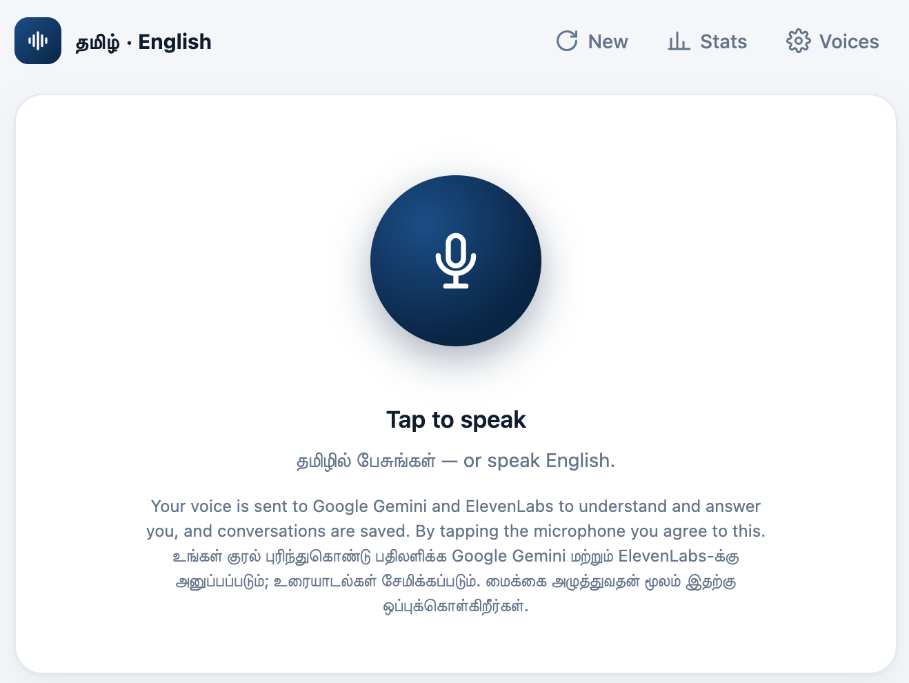

# speech-chatbot

A small voice assistant you talk to in Tamil or English. You tap the microphone,
ask a question, and it answers out loud in the same language. Tamil is the default.
English replies are spoken in one cloned voice and Tamil replies in another.



It is a single Flask app with one HTML page, built on three services:

- **Gemini** listens to the recording and writes the reply
- **ElevenLabs** speaks the reply in a cloned voice
- **Firestore** keeps conversations, per-turn metrics and daily usage

Originated by Project Harrison.

## How a turn works

1. The browser records the user between two taps, converts the audio to 16 kHz mono
   WAV and posts it to `/api/chat`, along with the last few messages of the conversation.
2. The server sends the audio and that history to Gemini (`gemini-3.5-flash-lite`) in a
   single request. Gemini returns structured JSON: what the user said, which language to
   answer in (`ta` or `en`), and the reply. There is no separate speech-to-text step.
3. The server saves the user message, the reply and the turn's metrics in one Firestore
   batch write, then returns the reply text.
4. The browser shows the text and requests the audio from
   `/api/conversations/<id>/messages/<id>/audio`. The server streams it from ElevenLabs
   (`eleven_v3`) as it is generated, and the browser starts playing once about two seconds
   of audio has arrived (Media Source Extensions). Typical time from "done talking" to
   hearing the reply is 3–5 seconds.

A few decisions that are easy to undo by accident:

- **`eleven_v3` is required for Tamil.** `eleven_multilingual_v2` produced gibberish when
  a cloned English voice spoke Tamil. `v3` was the only model that got it right, checked
  by transcribing the output back.
- **The browser sends the conversation history** instead of the server reading it from
  Firestore. Firestore is in `us-central1` and the app runs in `asia-south1`, so each
  round trip costs 0.3–1.3 s. Saving everything in one batch write is for the same reason.
- **Playback waits for about 2 seconds of buffered audio.** Starting on the first bytes
  made speech break up on slower connections.
- **The microphone stays open after the first tap**, so later taps start listening
  immediately. Nothing is recorded outside the two taps.

## Files

| File | What it is |
|---|---|
| `app.py` | The whole backend: login, voice management, chat, audio streaming, usage cap, metrics |
| `voice_studio.html` | The whole frontend: plain HTML, CSS and JavaScript, no build step |
| `login.html` | Password page |
| `firestore_client.py` | Firestore client for project `project-harrison` |
| `METRICS.md` | Definition of every metric the app records |
| `Dockerfile` | Container for Cloud Run |
| `.env.example` | The environment variables the app needs |

## Running it locally

You need Python 3.11+, an ElevenLabs account, a Gemini API key, and access to a Google
Cloud project with Firestore.

```bash
python3 -m venv .venv
.venv/bin/pip install -r requirements.txt
cp .env.example .env          # then fill in the values
gcloud auth application-default login   # Firestore uses your Google login locally
.venv/bin/python app.py
```

Then open http://localhost:8000. Browsers only allow the microphone on `localhost` or
HTTPS.

The ElevenLabs key needs these permissions: Text to Speech, Voices (read and write), and
User (read) for the plan balance in Stats.

## Deploying

It runs on Cloud Run as the service `voice-studio` in `asia-south1`, in the Google Cloud
project `project-harrison`.

```bash
gcloud run deploy voice-studio --source . --region asia-south1 --project project-harrison
```

Secrets come from Secret Manager rather than the image:

| Environment variable | Secret |
|---|---|
| `ELEVENLABS_API_KEY` | `voice-studio-elevenlabs-key` |
| `GEMINI_API_KEY` | `gemini-api-key` |
| `APP_PASSWORD` | `voice-studio-password` |
| `SECRET_KEY` | `voice-studio-session-key` |

The service runs as `voice-studio@project-harrison.iam.gserviceaccount.com`. That account
can read those four secrets and has `roles/datastore.user` for Firestore. The service is
capped at 2 instances and scales to zero when idle.

To change the password, add a new version of `voice-studio-password` and redeploy.

## Configuration

These live as constants at the top of `app.py`:

- `DEFAULT_VOICES`: the ElevenLabs voice used for each language. Users can override
  them per browser under **Voices**.
- `GEMINI_MODEL`, `TTS_MODEL`, and `SYSTEM_PROMPT`, which sets the language rules and
  keeps replies short enough to listen to.
- `DAILY_CHAR_LIMIT` (environment variable, default 10,000): how many characters can be
  spoken per day, India time. ElevenLabs bills per character, and 10,000 a day keeps a
  month inside the 300,000-character Creator plan. Past the limit, the app says so and
  stops until midnight IST.

## Voices

Voices are ElevenLabs instant voice clones. **Voices → New voice** records 30 seconds and
creates one. You can also clone from a file in the ElevenLabs dashboard or API. Only
cloned voices are listed in the app. Make sure the person whose voice is cloned has
agreed to it.

## Data in Firestore

| Collection | Contents |
|---|---|
| `voice_bot_conversations/{id}/messages` | Every user message and reply, with language and voice |
| `voice_bot_metrics/{message_id}` | One document per turn: timings, tokens, sizes, failures |
| `voice_bot_usage/{YYYY-MM-DD}` | Daily counters used for the cap |

Audio is never stored. Replies are re-synthesised if replayed after a page reload, which
costs credits again.

## Metrics

Every reply shows its own timings under the text. The **Stats** button shows
percentiles for each stage of the pipeline, usage against the daily cap, the ElevenLabs
balance, and failures by stage. The same data is available as JSON from
`/api/stats?days=7`. `METRICS.md` explains what each number means and where it is
measured.

## Known limitations

- One shared password, no individual accounts. Anyone logged in can create or delete
  voices.
- The service account's Firestore role covers the whole project, not just these
  collections. Firestore doesn't support narrower IAM.
- iOS Safari may block automatic playback. The reply's Play button still works.
- The Tamil text in the consent notice was not reviewed by a native speaker.
- There are no automated tests yet.
